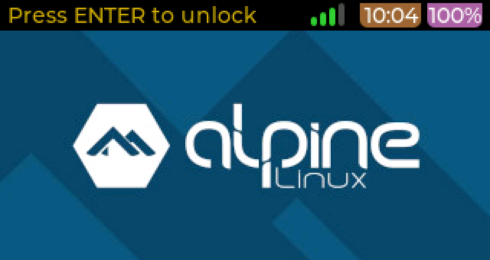
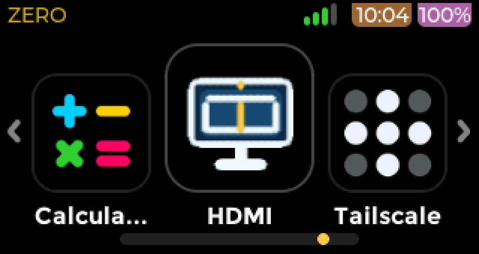
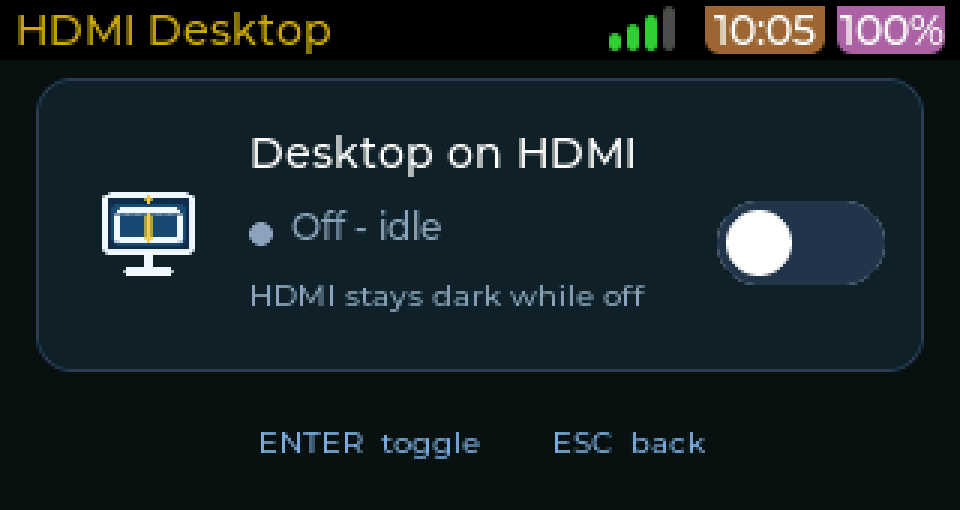
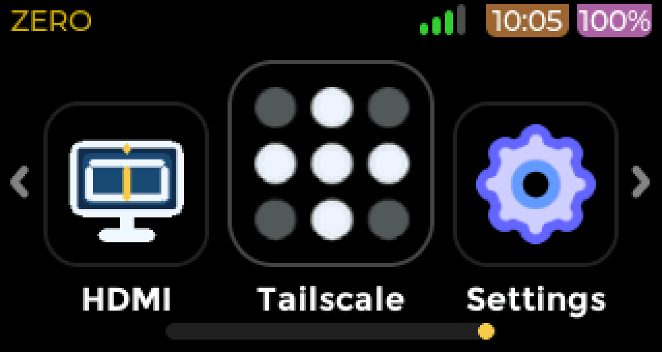
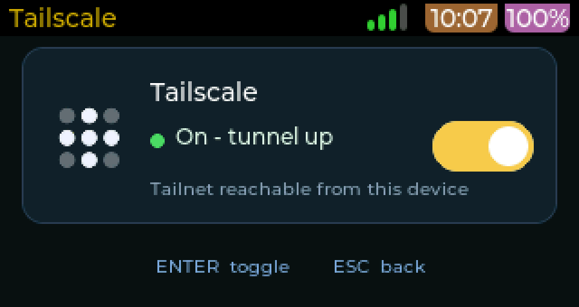

# cardputer-zero-alpine-linux

An extremely light, purpose-built **Alpine Linux** operating system for the
**M5Stack CardputerZero** (Raspberry Pi CM0 / RP3A0, Broadcom BCM2837).

**Status: v0.21.2.** The launcher face of the stock M5 image, on Alpine:
the APPLaunch UI (carousel, settings, Files, Camera, calculator, CLI
terminal) owns the internal LCD and boots straight into it. HDMI/Sway is
opt-in and stays dark until you start it. The v0.19.0 Sway keyboard and
HDMI-lock work is in this image; v0.20.0 added the Files browser and
Camera as default apps (both native musl builds), v0.20.1 fixes
MIPI-CSI camera startup and opens Files in `/home/cpz`, v0.21.0 makes
the `CPZDATA` persistence partition cover the whole card on **every** flash
route — `dd`, Imager and Etcher now get `/cfg` too, from the device, after
one extra reboot on a brand-new card — v0.21.1 installs `shadow` so
`passwd` works as `cpz` (Alpine's busybox applet is not setuid), and
v0.21.2 preserves root/cpz password changes across a reflash. Files and
Camera content lives under `/home/cpz`, so reflashes preserve it. The
device test checklist is in [docs/FLASH-AND-TEST.md](docs/FLASH-AND-TEST.md).

**Latest published release:** [CPZ-Alpine v0.20.1](https://github.com/kkazakov/cardputer-zero-alpine-linux/releases/tag/v0.20.1).
Download the ZIP (image + SHA-256 + Linux/Windows/macOS flashers + README),
not the loose image. v0.21.2 is built here and needs the hardware pass
before it is published — see [docs/FLASH-AND-TEST.md](docs/FLASH-AND-TEST.md).

## Screenshots

The internal 320×170 ST7789 panel, captured from `/dev/fb1` (shown here at
3×; the HDMI output is separate and only exists while a desktop session
runs).

<table>
  <tr>
    <td align="center" width="50%"><br><sub><b>Lock screen</b> — Alpine wallpaper; TAB arms, ENTER unlocks</sub></td>
    <td align="center" width="50%"><br><sub><b>Launcher</b> — HDMI card selected</sub></td>
  </tr>
  <tr>
    <td align="center"><br><sub><b>HDMI app</b> — desktop on demand, off by default</sub></td>
    <td align="center"><br><sub><b>Launcher</b> — Tailscale card, only when installed and logged in</sub></td>
  </tr>
  <tr>
    <td align="center"><br><sub><b>Tailscale app</b> — tunnel up; the choice survives a reboot</sub></td>
    <td align="center"></td>
  </tr>
</table>

| Subsystem | State | Notes |
|---|---|---|
| **Launcher UI (APPLaunch)** | ✅ v0.20.1 | upstream M5 carousel on the 320×170 LCD, built as a musl aarch64 binary (`build/25-launcher.sh`), OpenRC `applaunch` service running as user `cpz` |
| Launcher: Calculator | ✅ | `M5CardputerZero-Calculator` built from the same launcher checkout |
| Launcher: Files | ✅ v0.20.1 | native musl build of CardputerZero/Files (`build/26-apps.sh`); starts in `/home/cpz`, previews text/images/audio/video (`ffmpeg` for video), enabled by default |
| Launcher: Camera | ✅ v0.20.1 | native musl build of Camera 1.0.2, pinned to the image's libcamera 0.7.1 ABI; MIPI-CSI via RPi VC4 IPA + tuning, stills in `~/Pictures/DCIM/Camera`, clips in `~/Videos/Camera`, gallery built in |
| Launcher: Settings | ✅ | Wi-Fi/Ethernet, Bluetooth, brightness/volume, battery + BQ calibrate, Date & Time; RPi-OS-only updater/ADB pages hidden |
| Launcher: CLI terminal | ✅ | interactive bash over a PTY, rendered in LVGL |
| Console | ✅ | **14-pin expansion UART** at 115200 + SSH; no VT getty and no HDMI kernel console. HDMI stays dark until the desktop starts. The USB-C serial gadget is retired (dwc2 is host-only for Ethernet/USB-A) |
| Keyboard (46-key + SYM/FN) | ✅ v0.19.0 | keymap rebuilt from measured keycap legends: console `cpz-sym-keymap.map`, launcher `tca8418_keypad_m5stack_keymap.map`. In Sway the internal keypad gets Alt-as-Super and the `cpz:sym` XKB option; an external USB keyboard keeps real Alt/Super and US layout |
| Battery gauge (BQ27220) | ✅ | stock module was stale; rebuilt from M5 vendor source against exact distro headers |
| Keyboard LEDs | ✅ | expander host-wait marquee until the `READY` handshake (reg `0xB0`); one `i2cset` at boot |
| Wi-Fi (BCM43439) | ✅ v0.19.1 | NetworkManager owns wlan0; Settings → Wi-Fi can toggle the radio, scan, join WPA2, forget, and reconnect. `nmcli` runs through `/usr/local/bin/cpz-nmcli` (root via passwordless sudo) because there is no polkit on the image. Credentials may also be baked as an NM keyfile |
| Ethernet (SR9900A) | ✅ v0.12.2 | mainline r8152 ID patch, dwc2 host mode; field-verified DHCP + traffic |
| SSH (dropbear) | ✅ | over Wi-Fi or Ethernet; root password is `alpine` — change it before exposing the device |
| Persistence across reflashes | ✅ v0.21.3 | `CPZDATA` partition covering the rest of the card, hourly `cpz-save` + boot restore. Saves `/root`, `/home/cpz` (including Files content and camera media), dropbear keys, the **whole `/etc/NetworkManager` tree**, `/var/lib/applaunch` (launcher settings + HDMI/Tailscale preferences), and `/var/lib/tailscale` (optional Tailscale node key, so a reflash does not require re-login). `flash-cpz.sh` provisions it offline; `dd`/Imager/Etcher get it from the device on first boot (one extra reboot) |
| HDMI desktop (on demand) | ✅ v0.19.0 | `cpz-desktop start` → Sway + waybar + foot at 1080p60 in ~5 s, roughly 90 MiB with foot open; HDMI audio becomes default while running. Hotplug is consent-only (`/etc/cpz/hdmi-mode=ask`); a saved boot preference can still start it |
| Tailscale (on demand) | ✅ v0.21.3 | **optional** on-device package (`apk add tailscale tailscale-openrc` + `tailscale up`); the launcher card appears only once the node is installed **and** logged in, and switches the tunnel on/off. The choice survives a reboot (ON re-adds the runlevel service, OFF removes it) and the node key survives a reflash |
| LCD HDMI lock | ✅ v0.19.0 | after 1 s the LCD shows **HDMI LOCKED** and the launcher stops reading the internal keypad; hold ESC 2 s to stop the desktop and unlock. The exit path is LCD-only; no monitor is needed once a session is up |
| Bluetooth / IR | ⏳ | BT controller path verified; no user-facing IR app and no remote-test pass yet |

## Sway on HDMI (on demand)

The desktop is deliberately small: Sway (Wayland), waybar, and one foot
terminal on a black background. Nothing graphical starts at boot; the
BCM2837/512 MB board only pays for the desktop when you ask for it.

### Start, stop, and state

- Launcher: open the **HDMI** card and flip the switch.
- Shell: `cpz-desktop start`, `cpz-desktop stop`, `cpz-desktop status`.
- The launcher persists the choice in `/var/lib/applaunch/hdmi-desktop`
  (`1`/`0`). With `1`, `/etc/local.d/cpz-hdmi-boot.start` starts the
  session on the next boot; stopping it writes `0`.
- HDMI hotplug is **consent by default**: `/etc/cpz/hdmi-mode=ask` does
  not start a session. Set `auto` to start on hotplug, or `off` to ignore
  hotplug entirely.
- The session runs as user `cpz` through seatd. `cpz-desktop stop` kills
  Sway/waybar, stops seatd, and restores the internal ES8389 audio card.
- The output line in `/etc/cpz/sway.config` asks for
  `HDMI-A-1 1920x1080@60Hz`; edit it if your monitor needs another mode.

### Keys and the internal keyboard

Sway's `$mod` is **Super** (`Mod4`). The internal TCA8418 keypad has no
Super key, so in Sway the internal device's physical **Alt is remapped to
Super_L** with `altwin:swap_lalt_lwin`; the remap is scoped to
`1:1:tca8418c` and does **not** apply to an external USB keyboard. In the
launcher (outside Sway) Alt remains a normal modifier.

Stock bindings on the internal keypad therefore use Alt where a USB
keyboard uses Super:

| Action | Internal keypad | External keyboard |
|---|---|---|
| Terminal | `Alt+Enter` | `Super+Enter` |
| App launcher (bemenu) | `Alt+d` | `Super+d` |
| Close focused window | `Alt+Shift+Q` | `Super+Shift+Q` |
| Stop the whole desktop | `Alt+Shift+E` | `Super+Shift+E` |
| Reload Sway config | `Alt+Shift+C` | `Super+Shift+C` |
| Fullscreen | `Alt+f` | `Super+f` |
| Focus/floating toggle | `Alt+Space` / `Alt+Shift+Space` | `Super+Space` / `Super+Shift+Space` |
| Workspaces 0–9 | `Alt+1..0`; move with `Alt+Shift+1..0` | `Super+1..0`; move with `Super+Shift+1..0` |
| Next/previous workspace | `Alt+Tab` / `Alt+Shift+Tab` | `Super+Tab` / `Super+Shift+Tab` |
| Focus arrow direction | `Alt+Fn+Z/X/C/F` | `Super+Arrow` |
| Move window in direction | `Alt+Shift+Fn+Z/X/C/F` | `Super+Shift+Arrow` |

The internal arrow keys are **Fn+Z/X/C/F** (Left/Down/Right/Up, verified
from the live DT keymap). The rest of the internal keypad is ordinary
US-layout typing; the SYM layer supplies the printed symbols.

### SYM characters (`cpz:sym`)

The TCA8418 driver emits high evdev codes for the SYM layer
(`183..202`, `209..217`, `231..233`). Stock XKB's `inet(evdev)` section
runs **after** the layout and redefines those codes as F13–F24/media
keys, which is why SYM+1 used to type `XF86Tools` instead of `!`.

The fix is the `cpz:sym` XKB option: options are applied after
`inet(evdev)`, and the `cpz` layout includes `us(basic)` so external
keyboards still type US. The seat keymap is shared, so Sway sets
`cpz:sym` for all keyboards and adds Alt-as-Super only for the internal
keypad.

- The 32 SYM characters are:
  ``! @ # $ % ^ & * ( ) ~ ` _ - + = [ ] { } " < > \ | , . / ? ; : '``
- Examples verified on hardware: `SYM+1=!`, `SYM+2=@`, `SYM+Q=~`,
  `SYM+N=/`, `SYM+;=;`.
- XKB options are **comma-separated**. Keep the internal keypad's option
  as `"cpz:sym,altwin:swap_lalt_lwin"`; a space-separated list is treated
  as one unknown option and silently drops both.
- The launcher itself reads raw evdev and does not need Sway's XKB
  option; the console keymap and launcher keymap use the same measured
  legends.

### LCD lock and exit without a monitor

1. Starting Sway gives the launcher a **1 s grace period** (so the
   ENTER release that started the session does not leak into Sway).
2. The LCD then shows **HDMI LOCKED** and pauses launcher keypad input;
   keys go to the HDMI session instead of double-typing on both screens.
3. **Hold ESC for 2 s** to run `cpz-desktop stop`. A single ESC does
   nothing. `Alt+Shift+E` on the internal keypad (or `Super+Shift+E` on
   an external keyboard) also stops the whole desktop.
4. Once the lock is active, any Sway exit — the ESC hold,
   `Mod+Shift+E`, `cpz-desktop stop`, or a crash — unlocks the LCD and
   writes `0` to the HDMI preference, so the next boot stays dark.

The lock is driven by `pgrep -x sway`; the exit path is entirely on the
LCD and does not need a monitor. If `cpz-desktop stop` does not kill Sway
promptly, the lock escalates to `SIGKILL`; after a timeout it unlocks
anyway and writes the preference off.

### External keyboard

An external USB keyboard is a first-class Sway keyboard: real Super/Alt,
US layout, normal Sway bindings. It is not routed through the internal
keypad remap. The LCD lock still applies while a session is running; use
the LCD's ESC hold or `Mod+Shift+E` to stop the session.

## Tailscale (optional, on demand)

Tailscale is **not installed in the image**. The launcher ships the
**Tailscale** card and the `/usr/local/bin/cpz-tailscale` helper, but the
card stays hidden until the package is installed *and* the node has been
logged in. Nothing else on the image depends on it.

### 1. Install and enable the daemon

Over SSH (root; `cpz` can prefix everything with `sudo -n`):

```sh
apk add tailscale tailscale-openrc
rc-update add tailscale default      # start it at boot
rc-service tailscale start
```

`tailscale-openrc` provides `/etc/init.d/tailscale` — the service is named
**`tailscale`**, not `tailscaled` (that is only the daemon process name).
`apk add` also adds the package to `/etc/apk/world`, so the existing
`cpz-save` / reflash flow reinstalls it automatically after a reflash
(`/cfg/pkglist.txt`).

### 2. Log in (`tailscale up`)

```sh
tailscale up
```

It prints an authentication URL. Open that URL on a phone or desktop,
approve the device, and the command returns. Useful variants:

```sh
tailscale up --hostname=cardputer-zero   # nicer name in the admin console
tailscale up --ssh                       # Tailscale SSH instead of dropbear
tailscale up --accept-routes             # use subnet routes from the tailnet
tailscale up --advertise-exit-node       # offer this device as an exit node
```

Check the result:

```sh
tailscale status        # "cardputer-zero-alpine  kkazakov@  linux  -"
tailscale ip -4         # 100.x.y.z
```

### 3. Use the launcher card

Within ~20 s of the login completing (no launcher restart needed) the
**Tailscale** card appears in the home carousel, next to HDMI. Open it:

- **ENTER** flips the tunnel on/off; **ESC** returns home.
- The switch reflects the real daemon (`pidof tailscaled`), and the note
  line says whether the state will survive a reboot.
- **ON** adds `tailscale` to the default runlevel and starts it.
- **OFF** removes the runlevel link *first*, then stops the daemon. This
  is what makes OFF persist: OpenRC starts default-runlevel services
  before `/etc/local.d`, so a boot hook alone would reconnect briefly on
  every boot.

The preference lives in `/var/lib/applaunch/tailscale` (`1`/`0`) and is
re-applied at boot by `/etc/local.d/cpz-tailscale-boot.start`.

**Remote-access warning:** on a device reachable only through its tailnet
address, switching OFF drops your SSH session and the device disappears
from the tailnet. Use the serial console (14-pin UART, 115200) or the LAN
address if you need to turn it back on, or schedule a re-enable before
testing remotely:

```sh
nohup sh -c 'sleep 120; /usr/local/bin/cpz-tailscale apply on' &
```

### 4. Manual control (no launcher)

```sh
cpz-tailscale state          # on | off
cpz-tailscale on             # write preference 1 + start + enable at boot
cpz-tailscale off            # write preference 0 + stop + disable at boot
cpz-tailscale apply on       # start/enable now, leave the preference alone
cpz-tailscale apply off      # stop/disable now, leave the preference alone
cpz-tailscale available      # exit 0 only if installed AND logged in
cpz-tailscale boot           # re-apply the saved preference (boot hook)
```

`cpz-tailscale on|off` and the launcher page keep the same preference
file, so mixing them is safe.

### 5. Persistence across reflashes

`/var/lib/tailscale` (node key, login profile, prefs) is in `cpz-save`, so
a card reflash keeps the node logged in — no second `tailscale up`. The
package is reinstalled from `/etc/apk/world` + `/cfg/pkglist.txt` on the
first boot, and the boot hook starts the daemon once the binary exists.

Run `cpz-save` after changing anything Tailscale-related (the hourly job
also does it):

```sh
cpz-save
tar -tzf /cfg/save.tar.gz | grep var/lib/tailscale/tailscaled.state
```

The archive is `0600` because it carries the node key and Wi-Fi PSKs.

### Troubleshooting

| Symptom | Check |
| --- | --- |
| Card never appears | `cpz-tailscale available; echo $?` → must be `0`. It is `1` until both `/usr/sbin/tailscaled` + `/etc/init.d/tailscale` exist **and** `tailscaled.state` has a non-empty `_profiles` (`tailscale up` completed) |
| `rc-service tailscaled` says "does not exist" | Wrong name — the service is `tailscale` |
| Switch flips back immediately | `tail -f /var/log/tailscaled.log`; `rc-service tailscale status`; the launcher log is `/var/log/applaunch.log` |
| Card appears but is Off after reflash | `cpz-save` must have run **before** the reflash; check the archive for `var/lib/tailscale/tailscaled.state` |

## Wi-Fi and Ethernet

NetworkManager owns `wlan0` and `eth0`. Settings → Wi-Fi talks to NM
through the launcher; a baked profile (from `build/wifi-secret`) joins
automatically, otherwise join a visible WPA2 network and enter the
password on the device.

Alpine's NetworkManager package has **no polkit** installed, so `nmcli`
as user `cpz` fails with *"Not authorized to perform this operation"*
(radio changes) or *"Not authorized to control networking"* (connect).
The launcher therefore calls every `nmcli` through:

```sh
/usr/local/bin/cpz-nmcli   # exec sudo -n /usr/bin/nmcli "$@"
```

`cpz` already has passwordless sudo, so this adds no new privilege; it
just gives NM the root caller it expects. The same wrapper covers the
Ethernet settings page. If you are debugging from a shell, use the
wrapper rather than bare `nmcli`:

```sh
sudo -n /usr/local/bin/cpz-nmcli radio wifi
sudo -n /usr/local/bin/cpz-nmcli dev wifi list --rescan yes
sudo -n /usr/local/bin/cpz-nmcli -t -f DEVICE,TYPE,STATE,CONNECTION dev status
```

Expected state after a Settings join: `nmcli` reports the Wi-Fi device
`connected`, the profile appears under `nmcli con show`, and a reboot
rejoins automatically. The whole `/etc/NetworkManager` tree is saved by
`cpz-save`, including launcher-created profiles.

## Build

Docker-based and re-runnable; every input is pinned by hash
([build/INPUTS.md](build/INPUTS.md)):

```sh
sh build/20-rootfs.sh     # arm64 container: Alpine rootfs + overlay + launcher
sh build/30-image.sh      # partition, assemble, VERIFY (must end clean)
```

`20-rootfs.sh` also runs `build/25-launcher.sh`, which rebuilds APPLaunch
and Calculator inside the persistent `cpz-launcher-build` container and
installs them into `/usr/share/APPLaunch`, then `build/26-apps.sh`,
which builds Files and Camera in `cpz-apps-build` and installs their
binaries, desktop entries and assets. Requires Docker with `binfmt` for
arm64 emulation.

The verification pass writes `build/verification-report.txt` and must
contain **zero** `FAIL:` lines (it ends with `verification clean`). A
`FAIL:` is a blocker, not a warning.

## Flash (preserves your data)

```sh
sudo ./build/flash-cpz.sh /dev/sdX [image.img.gz]
```

Writes the fixed 1.8 GiB image (256 MiB FAT boot + 1.5 GiB ext4 root),
then creates the **CPZDATA** partition at the fixed 4 GiB offset up to the
end of the card, formats it only when it is missing/corrupt, and grows its
ext4 filesystem to the partition. On the device, hourly cron and on-demand
`cpz-save` snapshot `/root`, `/home/cpz` (the Files home tree,
`~/Pictures/DCIM/Camera` and `~/Videos/Camera`), dropbear keys,
`/etc/wpa_supplicant`, `/etc/hostname`, `/etc/hosts`, the full NetworkManager
config tree, `/var/lib/applaunch`, and additive `/etc/local.d`, `/etc/conf.d`,
and `/etc/apk/world` into `/cfg`; every boot restores them
(`cpz-restore.start`). Run `cpz-save` after a change you care about
— the next snapshot is not immediate.

**`dd` / Raspberry Pi Imager / balenaEtcher also work now.** They write only
p1/p2; on the first boot `cpz-grow.start` appends the CPZDATA entry to the
end of the card, reboots once, and formats it — so persistence arrives
without a desktop. One extra reboot on a brand-new card; a card that
already has CPZDATA from a previous `flash-cpz.sh` boot is untouched.
`/cfg` is sized to the card you flash, not to the image: a card whose
filesystem is smaller than its partition (flashed from a smaller card)
is grown on the next boot.

## Debugging aids shipped in the image

- `cpzdiag` — one-word field diagnostics; the report lands on the FAT
  boot partition and is readable from any desktop.
- **Serial rescue:** 14-pin expansion bus UART at **115200** (`ttyS0`,
  `console=serial0,115200`). There is no VT getty and no HDMI console.
- **SSH:** `ssh root@<ip>` (password `alpine`; change it). Prefer
  Wi-Fi/Ethernet SSH; the USB-C port is host-only and the serial gadget
  is retired.
- **Passwords:** `passwd` as `cpz` changes cpz's password (it asks for
  the current one). Root can reset either account without the old
  password: `sudo -n passwd cpz` or `sudo -n passwd root` — cpz has
  NOPASSWD sudo. v0.21.1 ships shadow's setuid `/usr/bin/passwd`; the
  busybox applet in earlier images failed with
  `passwd: must be suid to work properly`. Since v0.21.2, `cpz-save`
  stores only the root and cpz lines from `/etc/shadow` in a 0600
  `/cfg/shadow-users` file and `cpz-restore.start` merges them by name at
  boot, so those two password changes survive a reflash. Other accounts
  always come from the new image. Run `cpz-save` after changing a
  password (the hourly job also does it) or the last snapshot wins. This
  starts with v0.21.2: a password changed on an older image was never
  written to `/cfg`, so the first reflash to v0.21.2 still boots with
  `alpine` — set it again after boot, then save.
- `rc-service applaunch status`, `/var/log/applaunch.log` for the
  launcher; `cpz-desktop status` for the HDMI session.
- `/etc/local.d/*.start` scripts and the launcher sources document their
  own fix history, including dead ends already tried.

## Architecture (Phase A)

Stock M5 kernel `6.18.33+rpt-rpi-v8` + M5 out-of-tree modules + boot
firmware, grafted onto a minimal Alpine (musl/BusyBox/OpenRC) userland.
The kernel is bit-exact stock; where a driver was stale or missing
(battery gauge, Ethernet), the fix is an out-of-tree rebuild against the
exact matching distro headers — never a kernel fork.

Read in order: [PLAN.md](PLAN.md) (master plan) →
[docs/01-hardware-inventory.md](docs/01-hardware-inventory.md) →
[build/INPUTS.md](build/INPUTS.md) →
[docs/FLASH-AND-TEST.md](docs/FLASH-AND-TEST.md).

## Device summary

- **SoC:** Broadcom BCM2837 — 4× Cortex-A53 @ 1 GHz (Raspberry Pi CM0, RP3A0 SiP)
- **RAM:** 512 MB LPDDR2 — *the hard constraint everything is designed around*
- **Display:** 1.9″ ST7789V3 SPI LCD (320×170), HDMI out up to 1080p
- **Keyboard:** 46-key matrix on a TCA8418 I2C keypad controller
- **Networking:** 2.4 GHz Wi-Fi (BCM43439), BT 4.2/BLE, 10/100 Ethernet
  (SR9900A via the GL852G USB hub), USB 2.0
- **Peripherals:** IMX219 camera, ES8389 audio, BMI270+BMM150 IMU,
  RX8130CE RTC, BQ27220 fuel gauge, IR TX/RX, Grove HY2.0-4P,
  2.54 mm 14-pin expansion bus
- **Boot chain:** standard Raspberry Pi — closed VideoCore firmware on a
  FAT32 partition loads `kernel8.img` + DTB; everything above the kernel
  is ours.

512 MB of RAM means the desktop must be opt-in (PLAN §6/§8); the BCM2837
has no suspend-to-RAM, so power management is fast boot + blanking +
runtime PM.

## Sources

- [CardputerZero launcher — upstream](https://github.com/CardputerZero/launcher)
  and the [Alpine fork](https://github.com/kkazakov/cardputer-zero-launcher-alpine)
  this image builds (`launcher/` subfolder, branch `alpine`)
- [M5Stack CardputerZero product docs](https://docs.m5stack.com/en/CardputerZero)
- [M5Stack CardputerZero image guide](https://docs.m5stack.com/en/compute/cardputerzero/image)
- ["Taming the CardputerZero" — M. Birth](https://blog.mbirth.uk/2026/11/11/taming-the-cardputerzero.html)
- [It's FOSS: CardputerZero crowdfunding coverage + specs](https://itsfoss.com/news/cardputerzero-crowdfunding/)
- [Alpine Wiki: Raspberry Pi](https://wiki.alpinelinux.org/wiki/Raspberry_Pi)
- [Raspberry Pi Compute Module 0](https://www.raspberrypi.com/products/compute-module-zero/)
- [r8152: add vendor/device ID for CoreChips SR9900 (lore)](https://lore.kernel.org/all/20260613090154.1975753-1-zjzhao@edatec.cn/t/#u#1)

## License

GPL-2.0-or-later for the kernel/driver material (kernel headers, M5
vendor sources); the rest of the build system is yours to use. Vendor
sources retain their upstream licenses (`vendor/*/COPYING`).